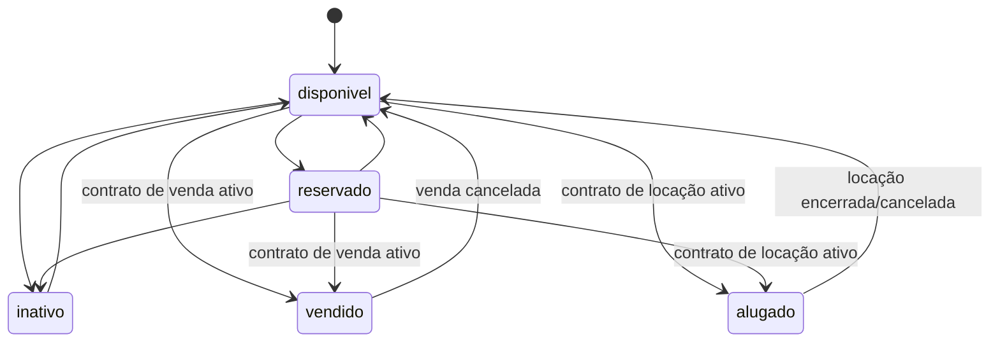
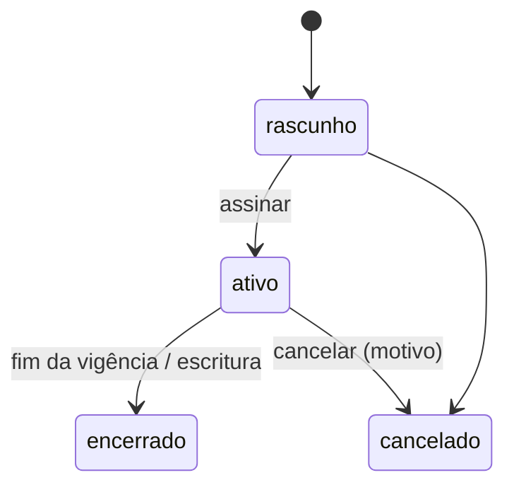

# Atrium — Máquinas de estado e fluxos críticos

> Regra do projeto: **nenhuma máquina de estado escondida** e **nenhuma regra de fluxo crítico espalhada pelo código**.
> Este documento é a especificação; a implementação vive em `src/domain/` e é a **única** fonte dessas regras.
> Implementação (Fase 5): `src/domain/<entidade>/estado.ts` (tabelas `TRANSICOES_*`, `pode…`, `transicoesPermitidas…`, `transicionar…`), `src/domain/comum/transacao.ts` (atomicidade, registro de alterações e desfazer), `src/domain/contrato/derivados.ts` e `src/domain/metricas/metricas.ts` (estados derivados), `src/domain/invariantes.ts` (`validarBase`). Testes ao lado de cada arquivo.

## 1. O problema que estamos evitando

Uma _hidden state machine_ aparece quando um estado e suas transições existem só implicitamente:

- Status alterado direto num componente (`lead.etapa = "fechado"`) ou com `setState` solto em vários lugares.
- Combinações de booleanos que formam estados não declarados (`isLoading && !isError && hasData`), incluindo estados impossíveis (`isLoading && isError`).
- A mesma regra ("só pode cancelar contrato ativo") repetida em botão, menu, atalho e API, cada cópia um pouco diferente.
- Efeitos colaterais de uma transição (gerar atividade, mudar status do imóvel, atualizar indicador) disparados por quem chamou, e não pela transição.

## 2. Regras obrigatórias

1. **Toda entidade com ciclo de vida tem uma máquina explícita** em `src/domain/<entidade>/estado.ts`: lista de estados, tabela de transições permitidas, _guards_ (condições) e efeitos.
2. **Um único ponto de mudança.** Só a função de transição do domínio (`transicionarLead`, `transicionarImovel`, `transicionarContrato`, `registrarPagamento`) altera o estado. UI, `fakeApi`, atalhos e ações em lote **chamam** essa função; nunca atribuem o campo.
3. **A UI pergunta, não decide.** O que habilitar/mostrar vem do domínio (`transicoesPermitidas(entidade)` / `podeTransicionar(entidade, alvo)`). Nenhum `if (status === …)` de regra de negócio em componente.
4. **Efeitos ficam na transição.** Gerar `Atividade` e o **registro de alteração** (§4), ajustar status do imóvel, preencher/limpar `motivoPerda`, montar o `desfazer` (RF-04): tudo dentro da função de transição, atomicamente.
5. **Estados derivados não são armazenados.** `inadimplente`, status da parcela, métricas e histórico do imóvel são calculados por funções puras em `src/domain/`, nunca gravados.
6. **Estado de UI assíncrono é uma união discriminada**, não booleanos: `{ fase: 'idle' | 'loading' | 'success' | 'error' | 'partial', … }` (o discriminante se chama `fase`, não `status`, para não colidir com o status das entidades nem com a regra de lint de fluxos críticos). Isso também garante os 5 estados obrigatórios de tela (RNF-09).
7. **Transição inválida falha alto**: lança erro tipado (`TransicaoInvalida`) em vez de ignorar em silêncio. Os tipos TS tornam impossível passar um estado fora do enum.
8. **Testes por transição**: cada máquina tem teste cobrindo todas as transições permitidas, as proibidas, os guards e os efeitos (Fase 5/10).
9. **Mudou a regra? Mude aqui primeiro.** Qualquer alteração em fluxo crítico atualiza este documento e a tabela em `estado.ts` no mesmo commit; a revisão (agente Opus) confere que não surgiu regra fora do domínio.

**Fluxos críticos** (as regras acima são obrigatórias para eles): etapa do lead, status e preço do imóvel, status e valores do contrato, pagamento de parcela, comissão, desfazer. Preço, status e valores monetários geram registro de alteração (§4).

## 3. Máquinas

### 3.1 Lead (`etapa`)

Etapas: `novo → contato → visita → proposta → fechado`, mais `perdido`. O lead pode ir para **qualquer** etapa (inclusive voltar ou pular), com só duas regras:

| Transição            | Guard                           | Efeitos                                                                           |
| -------------------- | ------------------------------- | --------------------------------------------------------------------------------- |
| qualquer → `perdido` | `motivoPerda` informado (RF-32) | grava motivo                                                                      |
| `perdido` → outra    | —                               | limpa `motivoPerda`                                                               |
| `fechado` → outra    | lead sem contrato vinculado     | —                                                                                 |
| todas                | —                               | Atividade `etapaAlterada`; registro de alteração (§4); atualiza `ordem` na coluna |

A UI recebe pronto (via `fakeApi.listLeads`): `destinosLead` (cada etapa de destino com `Permissao` e `exigeMotivo`, para "Mover para…") e `permissoesDeSoltar` (cada coluna do kanban; a própria coluna = reordenar, sempre permitido). Lead não encontrado na tela = soltar negado. Após qualquer movimento a UI pergunta `contratosVinculaveis` (RF-39: só lead `fechado`, contratos dos imóveis vistos, sem lead e não cancelados) e só oferece o vínculo se vier algum.

### 3.2 Imóvel (`status`)

| Origem da transição                     | Permitidas                                                                                      |
| --------------------------------------- | ----------------------------------------------------------------------------------------------- |
| **Usuário** (RF-25, RF-49)              | `disponivel ↔ reservado`, `disponivel/reservado → inativo` (com motivo), `inativo → disponivel` |
| **Sistema**, só via máquina do contrato | `→ vendido`, `→ alugado`, `vendido/alugado → disponivel`                                        |

Guard: imóvel com contrato ativo não aceita transição do usuário.

Na lista, cada imóvel chega com `transicoesPermitidasImovel` (já com o guard); o menu de lote (RF-49) usa `opcoesLoteImovel`, que permite um destino se ao menos um selecionado aceita (os demais são recusados por `transicionarImoveis` e listados no toast).

### 3.3 Contrato (`status`)

| Transição                    | Guard                                                               | Efeitos                                                                                                                                                |
| ---------------------------- | ------------------------------------------------------------------- | ------------------------------------------------------------------------------------------------------------------------------------------------------ |
| `rascunho → ativo`           | imóvel `disponivel`/`reservado`; `tipo` = finalidade                | imóvel → `vendido`/`alugado`; gera parcelas e comissões (se o rascunho não tiver: comissão do corretor do imóvel, 6 % venda / 10 % locação); Atividade |
| `ativo → encerrado`          | venda: escritura (todas as parcelas pagas); locação: `fim` atingido | locação: imóvel → `disponivel` (venda: segue `vendido`); Atividade                                                                                     |
| `ativo/rascunho → cancelado` | `motivoCancelamento` (RF-48)                                        | se estava `ativo`: imóvel → `disponivel` (rascunho não mexe no imóvel); parcelas não pagas passam a `cancelada` (derivado); Atividade                  |

`inadimplente` **não é estado**: é derivado (`ativo` + parcela atrasada).

Derivados entregues prontos à tela do contrato: `statusParcela` e `diasDeAtraso` por parcela, `resumoCronograma` (pagas, recebido, atrasadas, em atraso, a receber) e `repassesDoContrato` (RF-46; `null` quando não se aplica: venda ou locação sem taxa). Tudo pelo relógio do mock, nunca pelo relógio do navegador.

### 3.4 Parcela (derivada + uma ação)

Status derivado: `pago` (tem `pagoEm`) · `cancelada` (contrato cancelado, não paga) · `atrasado` (hoje > vencimento) · `aVencer`. A única ação é `registrarPagamento` (e seu `desfazer`), permitida só em contrato `ativo` e parcela não paga.

### 3.5 Visita (`status`)

`agendada → realizada | cancelada | naoCompareceu` (os três são finais). Agendar exige data futura e lead que não esteja `perdido`; marcar `realizada` acrescenta o imóvel em `imoveisVistos` do lead. Efeitos: Atividade `visitaAgendada`/`visitaRealizada`/`visitaCancelada` no lead, com o imóvel em `relacionados`.

Vincular contrato a lead (RF-39): só lead `fechado`, contrato sem lead e não cancelado; Atividade `contratoVinculado`.

### 3.6 Estado de tela (UI)

`idle → loading → success | partial | error`; `error → loading` (tentar de novo); `success → loading` (refetch mantém dados visíveis). Implementado como união discriminada num único hook por recurso, nunca como booleanos soltos: `Recurso<T>` e `useRecurso` em `src/lib/recurso.ts`.

### 3.7 Notificações e badges do shell (derivados)

Não são máquinas de estado: são leituras derivadas, calculadas em `src/domain/notificacoes/notificacoes.ts` (antes ficavam no `fakeApi`). `listarNotificacoes` usa a mesma regra de `statusParcela` (vence em até 3 dias → `vencimento`; vencida → `atraso`; só contratos `ativo`) e as atividades de outras pessoas dos últimos 14 dias; `lida` vem da lista de ids lidos do usuário (único estado guardado, sem transição de negócio). `contadoresNavegacao` conta leads em `novo` e parcelas atrasadas de contratos ativos (mesma regra do "inadimplente"). O shell só exibe.

### 3.8 Recorte por persona (RF-08)

`recortePadrao(usuario)` (`src/domain/corretor/operacoes.ts`): corretor vê só os registros dos quais é responsável; gestor e financeiro veem tudo. Imóveis e Leads usam essa função para o filtro inicial; o usuário pode desfazer o recorte.

## 4. Registro de alterações

Objetivo: deixar claro **quem alterou preço, status ou valores monetários, quando, e de quanto para quanto**. A edição continua livre; só fica registrada.

**O que é registrado:**

- **Preço e valores monetários:** preço, condomínio e IPTU do imóvel; orçamento do lead; valor do contrato, taxa de administração, pagamento de parcela e comissão.
- **Status:** status do imóvel, etapa do lead, status do contrato.

**Cada registro guarda:** quem (usuário atual), quando, o campo, o valor anterior e o novo.

**Como:** toda escrita do domínio roda em `transacao()`, que compara antes/depois os campos monitorados (`camposMonitorados`: imóvel `preco/condominio/iptu/status`; lead `etapa/orcamento`; contrato `status/valor/taxaAdministracao/parcela.N.valor/parcela.N.pagoEm/comissao.N.valor/comissao.N.pagaEm`) e grava um registro por campo alterado (regra 4), então não há como mudar sem registrar. Criação de entidade ou de parcela não é alteração. "Desfazer" é só mais uma alteração e também aparece. Na UI, o detalhe de imóvel, lead e contrato mostra a seção "Histórico de alterações" (RF-65).
