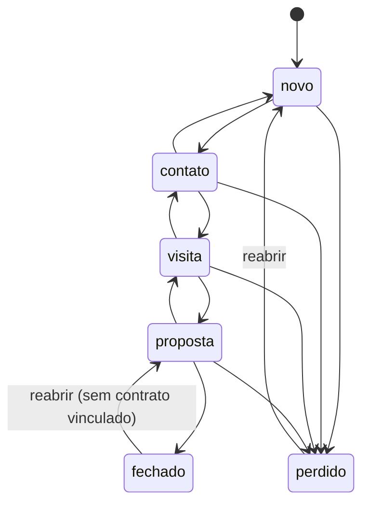
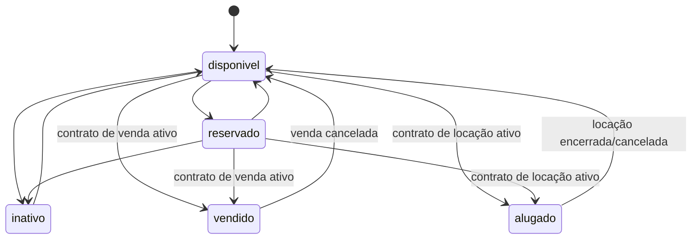
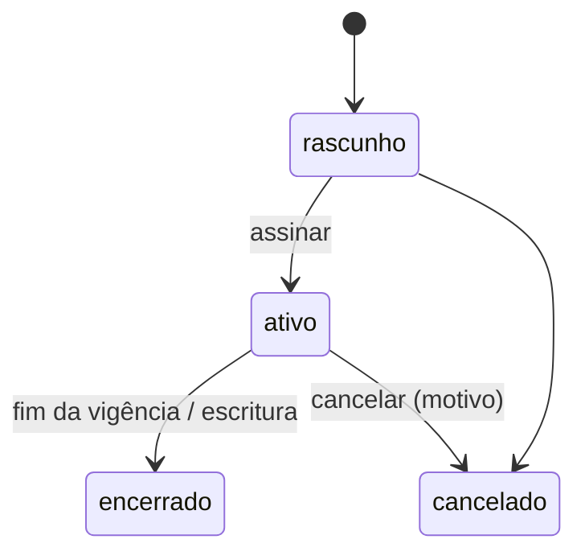

# Atrium — Máquinas de estado e fluxos críticos

> Regra do projeto: **nenhuma máquina de estado escondida** e **nenhuma regra de fluxo crítico espalhada pelo código**.
> Este documento é a especificação; a implementação vive em `src/domain/` (Fase 3/5) e é a **única** fonte dessas regras.

## 1. O problema que estamos evitando

Uma *hidden state machine* aparece quando um estado e suas transições existem só implicitamente:

- Status alterado direto num componente (`lead.etapa = "fechado"`) ou com `setState` solto em vários lugares.
- Combinações de booleanos que formam estados não declarados (`isLoading && !isError && hasData`), incluindo estados impossíveis (`isLoading && isError`).
- A mesma regra ("só pode cancelar contrato ativo") repetida em botão, menu, atalho e API, cada cópia um pouco diferente.
- Efeitos colaterais de uma transição (gerar atividade, mudar status do imóvel, atualizar indicador) disparados por quem chamou, e não pela transição.

## 2. Regras obrigatórias

1. **Toda entidade com ciclo de vida tem uma máquina explícita** em `src/domain/<entidade>/estado.ts`: lista de estados, tabela de transições permitidas, *guards* (condições) e efeitos.
2. **Um único ponto de mudança.** Só a função de transição do domínio (`transicionarLead`, `transicionarImovel`, `transicionarContrato`, `registrarPagamento`) altera o estado. UI, `fakeApi`, atalhos e ações em lote **chamam** essa função; nunca atribuem o campo.
3. **A UI pergunta, não decide.** O que habilitar/mostrar vem do domínio (`transicoesPermitidas(entidade)` / `podeTransicionar(entidade, alvo)`). Nenhum `if (status === …)` de regra de negócio em componente.
4. **Efeitos ficam na transição.** Gerar `Atividade` e a entrada de **auditoria** (§4), ajustar status do imóvel, preencher/limpar `motivoPerda`, montar o `desfazer` (RF-04): tudo dentro da função de transição, atomicamente.
5. **Estados derivados não são armazenados.** `inadimplente`, status da parcela, métricas e histórico do imóvel são calculados por funções puras em `src/domain/`, nunca gravados.
6. **Estado de UI assíncrono é uma união discriminada**, não booleanos: `{ status: 'idle' | 'loading' | 'success' | 'error' | 'partial', … }`. Isso também garante os 5 estados obrigatórios de tela (RNF-09).
7. **Transição inválida falha alto**: lança erro tipado (`TransicaoInvalida`) em vez de ignorar em silêncio. Os tipos TS tornam impossível passar um estado fora do enum.
8. **Testes por transição**: cada máquina tem teste cobrindo todas as transições permitidas, as proibidas, os guards e os efeitos (Fase 5/10).
9. **Mudou a regra? Mude aqui primeiro.** Qualquer alteração em fluxo crítico atualiza este documento e a tabela em `estado.ts` no mesmo commit; a revisão (agente Opus) confere que não surgiu regra fora do domínio.

**Fluxos críticos** (as regras acima são obrigatórias para eles): etapa do lead, status e preço do imóvel, status e valores do contrato, pagamento de parcela, comissão, desfazer. Todos geram auditoria (§4).

## 3. Máquinas

### 3.1 Lead (`etapa`)

| De → Para | Guard | Efeitos |
|---|---|---|
| qualquer → `perdido` | `motivoPerda` informado (RF-32) | grava motivo; Atividade `etapaAlterada` |
| `perdido` → `novo` | — | limpa `motivoPerda`; Atividade |
| `proposta` → `fechado` | — | Atividade; oferece vincular contrato (RF-39) |
| `fechado` → `proposta` | lead **sem** contrato vinculado | Atividade |
| avançar/voltar uma etapa | — | Atividade; atualiza `ordem` na coluna |
| saltos (ex.: `novo` → `proposta`) | **não permitidos**; o kanban mostra a coluna como alvo inválido | — |

### 3.2 Imóvel (`status`)

| Origem da transição | Permitidas |
|---|---|
| **Usuário** (RF-25, RF-49) | `disponivel ↔ reservado`, `disponivel/reservado → inativo` (com motivo), `inativo → disponivel` |
| **Sistema**, só via máquina do contrato | `→ vendido`, `→ alugado`, `vendido/alugado → disponivel` |

Guard: imóvel com contrato ativo não aceita transição do usuário.

### 3.3 Contrato (`status`)

| Transição | Guard | Efeitos |
|---|---|---|
| `rascunho → ativo` | imóvel `disponivel`/`reservado`; `tipo` = finalidade | imóvel → `vendido`/`alugado`; gera parcelas e comissões; Atividade |
| `ativo → encerrado` | venda: escritura; locação: `fim` atingido | locação: imóvel → `disponivel`; Atividade |
| `ativo/rascunho → cancelado` | `motivoCancelamento` (RF-48) | imóvel → `disponivel`; parcelas futuras deixam de valer; Atividade |

`inadimplente` **não é estado**: é derivado (`ativo` + parcela atrasada).

### 3.4 Parcela (derivada + uma ação)

Status derivado: `pago` (tem `pagoEm`) · `atrasado` (hoje > vencimento) · `aVencer`. A única ação é `registrarPagamento` (e seu `desfazer`), permitida só em contrato `ativo` e parcela não paga.

### 3.5 Estado de tela (UI)

`idle → loading → success | partial | error`; `error → loading` (tentar de novo); `success → loading` (refetch mantém dados visíveis). Implementado como união discriminada num único hook por recurso, nunca como booleanos soltos.

## 4. Log de auditoria

Toda alteração em dado crítico gera uma entrada de auditoria **imutável**, escrita pela própria transição do domínio (regra 4), nunca pela UI. A `Atividade` é a linha do tempo amigável para o usuário; a auditoria é o registro técnico completo de **quem mudou o quê, de quanto para quanto, quando e por quê**.

### 4.1 O que é auditado

| Entidade | Campos/ações auditados |
|---|---|
| Imóvel | `preco`, `condominio`, `iptu`, `status` (+ `motivoInativo`), `finalidade`, `corretorId`, criação |
| Lead | `etapa` (+ `motivoPerda`), `responsavelId`, `orcamento`, vínculo com contrato, criação |
| Contrato | `status` (+ `motivoCancelamento`), `valor`, `inicio`/`fim`, `taxaAdministracao`, partes, criação |
| Parcela | registro e estorno de pagamento (`pagoEm`) |
| Comissão | `percentual`, `base`, `pagaEm` |
| Sistema | "Restaurar dados mock", mudança de persona/usuário atual |

Campos de apresentação (descrição, diferenciais, favorito, ordem no kanban) **não** são auditados.

### 4.2 Regras

1. **Só acrescenta (append-only).** Nenhuma entrada é editada ou apagada. O tipo exposto é `readonly`, e o repositório só tem `registrar` e `listar`.
2. **Mesma transação da mudança.** Se a auditoria falhar, a mudança é desfeita. Não existe alteração crítica sem entrada correspondente.
3. **Antes e depois por campo.** Cada entrada lista `{ campo, de, para }` com valores brutos (centavos, enums), não textos formatados.
4. **Desfazer não apaga nada.** "Desfazer" (RF-04) é uma nova transição que gera uma entrada **compensatória** com `origem: 'desfazer'` e `desfazId` apontando para a original. A `Atividade` original é marcada `desfeita: true` e continua no histórico.
5. **Ações em lote** (RF-49) geram uma entrada por entidade, todas com o mesmo `correlacaoId`.
6. **Motivo obrigatório** quando a transição exige (perda de lead, inativação, cancelamento) e opcional nas demais.
7. **Sem dados sensíveis em claro.** Documentos de partes aparecem mascarados também na auditoria.
8. **Reset do mock** limpa os dados de demonstração e começa a auditoria com uma entrada `sistema.reset`, para que o log nunca pareça "vazio sem motivo".

### 4.3 Onde aparece

- Aba **Auditoria** no detalhe de imóvel, lead e contrato (RF-65).
- Tela **Configurações → Auditoria** com filtros por entidade, campo, autor, origem e período, e exportação CSV (RF-66).
