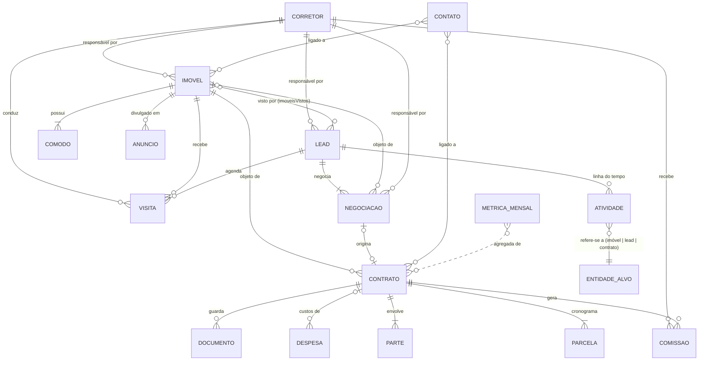

# Atrium — Modelo de dados mock (desenho)

> Desenho da Fase 2, implementado na Fase 5: schemas Zod e tipos em `src/domain/<entidade>/schema.ts`, gerador determinístico em `src/mocks/data/gerador.ts` (`gerarBase({ semente, hoje })`, casos de borda em `CASOS_DE_BORDA`), `fakeApi` em `src/mocks/services/fakeApi.ts`.
> Convenções: IDs são strings com prefixo (`imv_…`, `lead_…`); datas em ISO 8601; **valores monetários em centavos (inteiros)**; áreas em m² (número); enums em minúsculas sem acento no código e rotulados em pt-BR na UI.

## 1. Diagrama de entidades

## 2. Entidades

### Corretor

| Campo           | Tipo                               | Notas                                     |
| --------------- | ---------------------------------- | ----------------------------------------- |
| id              | `cor_…`                            |                                           |
| nome            | string                             | inclui 1 nome muito longo (caso de borda) |
| email, telefone | string                             | fictícios, sem dados reais                |
| creci           | string                             | formato `CRECI-SP 123456-F` fictício      |
| avatar          | `{ iniciais, variante? }`          | ilustração SVG ou iniciais (Fase 5)       |
| papel           | `gestor \| corretor \| financeiro` | usado pelo seletor de persona (RF-08)     |
| metaMensal      | centavos                           | para "meta x realizado" no dashboard      |
| ativo           | boolean                            |                                           |

### Imovel

| Campo                             | Tipo                                                                                           | Notas                                                             |
| --------------------------------- | ---------------------------------------------------------------------------------------------- | ----------------------------------------------------------------- |
| id, codigo                        | `imv_…`, `AT-0001`                                                                             | código visível e buscável (RF-22)                                 |
| titulo, descricao                 | string                                                                                         | 1 título muito longo                                              |
| tipo                              | `casa \| apartamento \| cobertura \| terreno \| comercial`                                     | define a ilustração da fachada                                    |
| finalidade                        | `venda \| locacao`                                                                             |                                                                   |
| status                            | `disponivel \| reservado \| vendido \| alugado \| inativo`                                     | ver regras §3                                                     |
| preco                             | centavos                                                                                       | venda: valor total; locação: aluguel mensal                       |
| condominio, iptu                  | centavos \| null                                                                               | IPTU anual; terreno sem condomínio                                |
| areaUtil, areaTotal               | número (m²)                                                                                    | `areaUtil ≤ areaTotal`                                            |
| quartos, suites, banheiros, vagas | inteiro                                                                                        | `suites ≤ quartos`; terreno = 0                                   |
| endereco                          | `{ logradouro, numero, bairro, cidade, uf, cep }`                                              | bairros plausíveis e genéricos                                    |
| comodos                           | `Comodo[]`                                                                                     | ≥ 1 exceto terreno                                                |
| diferenciais                      | string[]                                                                                       | ex.: piscina, academia, portaria 24 h                             |
| corretorId                        | → Corretor                                                                                     |                                                                   |
| favorito                          | boolean                                                                                        | RF-28                                                             |
| fachada                           | `terrea \| sobrado \| moderna \| predio \| cobertura \| campo \| comercial \| terreno` \| null | ilustração; `null` = sem ilustração (fallback do `PropertyImage`) |
| motivoInativo                     | string \| null                                                                                 | quando `inativo`                                                  |
| criadoEm, atualizadoEm            | ISO                                                                                            |                                                                   |

### Comodo (valor embutido em Imovel)

| Campo | Tipo                                                                                       | Notas                   |
| ----- | ------------------------------------------------------------------------------------------ | ----------------------- |
| tipo  | `sala \| cozinha \| quarto \| banheiro \| varanda \| garagem \| areaGourmet \| escritorio` | define a ilustração SVG |
| nome  | string                                                                                     | ex.: "Suíte master"     |
| area  | número (m²) \| null                                                                        |                         |

### Lead

| Campo                  | Tipo                                                        | Notas                                |
| ---------------------- | ----------------------------------------------------------- | ------------------------------------ |
| id                     | `lead_…`                                                    |                                      |
| nome                   | string                                                      |                                      |
| contato                | `{ telefone?, email? }`                                     | **pode estar vazio** (caso de borda) |
| origem                 | `site \| portal \| indicacao \| whatsapp \| placa \| redes` |                                      |
| interesse              | `{ finalidade, tipos[], bairros[], quartosMin? }`           |                                      |
| orcamento              | centavos \| null                                            | usado no card sem imóvel             |
| imoveisVistos          | → Imovel[]                                                  | N:N                                  |
| responsavelId          | → Corretor                                                  |                                      |
| criadoEm, atualizadoEm | ISO                                                         |                                      |

A pessoa. Etapa, motivo de perda e posição no kanban ficam na **Negociação** (RF-70). Todo lead tem ao menos uma negociação.

### Negociacao

| Campo                  | Tipo                                                                   | Notas                                        |
| ---------------------- | ---------------------------------------------------------------------- | -------------------------------------------- |
| id                     | `neg_…`                                                                |                                              |
| leadId                 | → Lead                                                                 |                                              |
| imovelId               | → Imovel \| null                                                       | `null` = interesse ainda sem imóvel definido |
| etapa                  | `novo \| contato \| visita \| proposta \| fechado \| perdido`          | kanban (RF-30), máquina em ESTADOS §3.1      |
| motivoPerda            | `preco \| localizacao \| desistencia \| concorrencia \| outro` \| null | obrigatório se `perdido` (RF-32)             |
| responsavelId          | → Corretor                                                             | padrão: responsável do lead                  |
| ordem                  | número                                                                 | posição dentro da coluna do kanban           |
| criadoEm, atualizadoEm | ISO                                                                    |                                              |

### Visita

| Campo                        | Tipo                                                  | Notas                                    |
| ---------------------------- | ----------------------------------------------------- | ---------------------------------------- |
| id                           | `vis_…`                                               |                                          |
| imovelId, leadId, corretorId | refs                                                  |                                          |
| dataHora                     | ISO                                                   | alimenta "próximos compromissos" (RF-14) |
| status                       | `agendada \| realizada \| cancelada \| naoCompareceu` |                                          |
| observacao                   | string?                                               |                                          |

### Contrato

| Campo              | Tipo                                          | Notas                                                  |
| ------------------ | --------------------------------------------- | ------------------------------------------------------ |
| id, numero         | `ctr_…`, `CT-2026-0001`                       |                                                        |
| tipo               | `venda \| locacao`                            | igual à finalidade do imóvel                           |
| imovelId           | → Imovel                                      |                                                        |
| negociacaoId       | → Negociacao \| null                          | negociação que originou (fechada); o lead vem dela     |
| partes             | `Parte[]`                                     |                                                        |
| valor              | centavos                                      | venda: total; locação: aluguel mensal                  |
| inicio, fim        | ISO (data)                                    | venda: `fim` = data da escritura; locação: 12–30 meses |
| status             | `rascunho \| ativo \| encerrado \| cancelado` | "inadimplente" é **derivado** (§3)                     |
| motivoCancelamento | string \| null                                | RF-48                                                  |
| taxaAdministracao  | % \| null                                     | só locação (repasse, RF-46)                            |
| parcelas           | `Parcela[]`                                   |                                                        |
| comissoes          | `Comissao[]`                                  |                                                        |

### Parte (valor embutido em Contrato)

| Campo           | Tipo                                                      |
| --------------- | --------------------------------------------------------- |
| papel           | `comprador \| vendedor \| locatario \| locador \| fiador` |
| nome, documento | string (documento fictício e mascarado na UI)             |

### Parcela (valor embutido em Contrato)

| Campo      | Tipo                                                                                                                        | Notas            |
| ---------- | --------------------------------------------------------------------------------------------------------------------------- | ---------------- |
| numero     | inteiro                                                                                                                     | 1…n              |
| vencimento | ISO (data)                                                                                                                  |                  |
| valor      | centavos                                                                                                                    |                  |
| pagoEm     | ISO \| null                                                                                                                 |                  |
| status     | **derivado**: `pago` se `pagoEm`; `cancelada` se o contrato foi cancelado; `atrasado` se hoje > vencimento; senão `aVencer` | não é armazenado |

### Comissao (valor embutido em Contrato)

| Campo       | Tipo                                                                                                                     |
| ----------- | ------------------------------------------------------------------------------------------------------------------------ |
| corretorId  | → Corretor                                                                                                               |
| percentual  | %                                                                                                                        |
| base        | centavos: **venda** = valor total do contrato; **locação** = primeiro aluguel (`valor` mensal), comissão única no início |
| valor       | centavos (derivado: base × percentual)                                                                                   |
| competencia | `AAAA-MM` (venda: mês da assinatura; locação: mês de `inicio`) — usada em "comissões do mês" (RF-44)                     |
| pagaEm      | ISO \| null                                                                                                              |

### Contato

| Campo                  | Tipo                                                                     | Notas              |
| ---------------------- | ------------------------------------------------------------------------ | ------------------ |
| id                     | `ctt_…`                                                                  |                    |
| nome                   | string                                                                   |                    |
| papel                  | `proprietario \| advogado \| cartorio \| despachante \| fiador \| outro` | RF-74              |
| telefone, email        | string?                                                                  | fictícios          |
| observacao             | string?                                                                  |                    |
| imovelIds, contratoIds | → Imovel[], → Contrato[]                                                 | vínculos opcionais |
| criadoEm, atualizadoEm | ISO                                                                      | sem ciclo de vida  |

### Anuncio (demonstração, RF-75)

| Campo                   | Tipo                                            | Notas                               |
| ----------------------- | ----------------------------------------------- | ----------------------------------- |
| id                      | `anc_…`                                         |                                     |
| imovelId                | → Imovel                                        |                                     |
| canal                   | `site \| portal \| classificados \| redes`      | rótulos genéricos, sem marcas reais |
| status                  | `rascunho \| publicado \| pausado \| encerrado` | máquina em ESTADOS §3.8             |
| publicadoEm             | ISO \| null                                     | primeira publicação                 |
| visualizacoes, contatos | inteiro                                         | números fictícios do gerador        |
| criadoEm, atualizadoEm  | ISO                                             |                                     |

### Documento (RF-76)

| Campo         | Tipo                                                                                    | Notas                                                                                     |
| ------------- | --------------------------------------------------------------------------------------- | ----------------------------------------------------------------------------------------- |
| id            | `doc_…`                                                                                 |                                                                                           |
| contratoId    | → Contrato                                                                              |                                                                                           |
| tipo          | `contratoAssinado \| documentoPessoal \| matricula \| certidao \| comprovante \| outro` |                                                                                           |
| nome          | string                                                                                  | nome do arquivo                                                                           |
| mime, tamanho | string, bytes                                                                           | PDF, JPG ou PNG, até 10 MB                                                                |
| arquivoId     | string \| null                                                                          | chave do arquivo no IndexedDB; `null` = exemplo do gerador (baixa um PDF de demonstração) |
| enviadoPorId  | → Corretor                                                                              |                                                                                           |
| enviadoEm     | ISO                                                                                     |                                                                                           |

### Despesa (RF-78)

| Campo                  | Tipo                                                                               | Notas                                             |
| ---------------------- | ---------------------------------------------------------------------------------- | ------------------------------------------------- |
| id                     | `dsp_…`                                                                            |                                                   |
| categoria              | `imposto \| cartorio \| certidao \| taxa \| despachante \| outro`                  | impostos e burocracia de contratos e documentação |
| descricao              | string                                                                             | ex.: "ITBI", "Registro da escritura"              |
| valor                  | centavos                                                                           |                                                   |
| vencimento             | ISO (data)                                                                         |                                                   |
| pagaEm                 | ISO \| null                                                                        |                                                   |
| contratoId             | → Contrato \| null                                                                 |                                                   |
| status                 | **derivado**: `paga` se `pagaEm`; `atrasada` se hoje > vencimento; senão `aVencer` | não é armazenado                                  |
| criadoEm, atualizadoEm | ISO                                                                                |                                                   |

### Atividade

| Campo        | Tipo                                                                                                                                                                                                                                                                                                                                                    | Notas                                                                                                                                                                                                                                                                     |
| ------------ | ------------------------------------------------------------------------------------------------------------------------------------------------------------------------------------------------------------------------------------------------------------------------------------------------------------------------------------------------------- | ------------------------------------------------------------------------------------------------------------------------------------------------------------------------------------------------------------------------------------------------------------------------- |
| id           | `atv_…`                                                                                                                                                                                                                                                                                                                                                 |                                                                                                                                                                                                                                                                           |
| tipo         | `etapaAlterada \| nota \| visitaAgendada \| visitaRealizada \| visitaCancelada \| propostaEnviada \| imovelCriado \| precoAlterado \| statusAlterado \| pagamentoRegistrado \| contratoCriado \| contratoVinculado \| negociacaoCriada \| imovelDefinido \| anuncioAlterado \| documentoAdicionado \| documentoRemovido \| comissaoPaga \| despesaPaga` | `etapaAlterada`, `negociacaoCriada`, `imovelDefinido` e `contratoVinculado` têm alvo = lead e `dados.negociacaoId`; `anuncioAlterado` tem alvo = imóvel; documento, comissão e despesa com contrato têm alvo = contrato; despesa avulsa paga tem alvo = a própria despesa |
| alvo         | `{ tipo: 'imovel' \| 'lead' \| 'contrato', id }`                                                                                                                                                                                                                                                                                                        | relação polimórfica principal                                                                                                                                                                                                                                             |
| relacionados | `{ tipo, id }[]`                                                                                                                                                                                                                                                                                                                                        | outras entidades afetadas (ex.: visita aparece na linha do tempo do lead **e** do imóvel)                                                                                                                                                                                 |
| autorId      | → Corretor                                                                                                                                                                                                                                                                                                                                              |                                                                                                                                                                                                                                                                           |
| dados        | objeto por tipo                                                                                                                                                                                                                                                                                                                                         | ex.: `{ de: 'visita', para: 'proposta' }`                                                                                                                                                                                                                                 |
| criadoEm     | ISO                                                                                                                                                                                                                                                                                                                                                     | feed do dashboard (RF-13) e linhas do tempo (RF-26, RF-34). O histórico do imóvel é derivado daqui (atividades com o imóvel em `alvo` ou `relacionados`), não é armazenado à parte                                                                                        |

### RegistroAlteracao

| Campo    | Tipo                                                                                       | Notas                                               |
| -------- | ------------------------------------------------------------------------------------------ | --------------------------------------------------- |
| id       | `alt_…`                                                                                    |                                                     |
| em       | ISO                                                                                        | quando                                              |
| autorId  | → Corretor                                                                                 | quem (usuário atual no mock)                        |
| entidade | `{ tipo: 'imovel' \| 'lead' \| 'negociacao' \| 'contrato' \| 'anuncio' \| 'despesa', id }` |                                                     |
| campo    | string                                                                                     | ex.: `preco`, `status`, `valor`, `parcela.3.pagoEm` |
| de, para | valor bruto                                                                                | centavos ou enum; formatado só na UI                |

Gravado pelo domínio sempre que preço, status ou valor monetário muda ([`ESTADOS-E-FLUXOS.md §4`](./ESTADOS-E-FLUXOS.md#4-registro-de-alterações)).

### MetricaMensal (derivada)

`{ mes: 'AAAA-MM', receitaVendas, receitaLocacoes, comissoes, leadsNovos, visitas, contratosFechados }` — **calculada na consulta** (`getDashboard`/`getFinanceiro`) a partir de contratos, parcelas, comissões, leads e visitas, para refletir imediatamente qualquer alteração salva (ex.: RF-43). Não é armazenada; uma cópia pré-calculada existe só como _fixture_ de teste para conferir o cálculo.

Métricas que dependem do passado leem o **registro de alterações**: o KPI de imóveis ativos (RF-10) usa o status que cada imóvel tinha no fim de cada mês (`statusImovelEm`), e o funil (RF-12) conta o lead perdido na etapa em que estava ao ser perdido (`etapaDaPerda`, campo `perdidos`), sem inflar a conversão.

## 3. Regras e invariantes

Garantidas pelo gerador do mock **e** pelas máquinas de estado do domínio, que são o único ponto de mudança de status (o `fakeApi` só as chama). Transições, guards e efeitos completos: [`ESTADOS-E-FLUXOS.md`](./ESTADOS-E-FLUXOS.md).

1. Contrato de **venda** `ativo`/`encerrado` ⇒ imóvel `vendido`; contrato de **locação** `ativo` ⇒ imóvel `alugado`. Ao encerrar uma locação ou cancelar um contrato, o imóvel volta a `disponivel`.
2. `vendido`/`alugado` só são atingidos via contrato (RF-25); `setStatusImovel` aceita apenas `disponivel ↔ reservado ↔ inativo` e recusa a mudança se o imóvel tiver contrato ativo.
3. `Contrato.negociacaoId` preenchido ⇒ essa negociação está `fechado` e tem o mesmo imóvel do contrato. O inverso não é exigido: uma negociação pode estar `fechado` sem contrato vinculado (RF-39).
4. Negociação `perdido` ⇒ `motivoPerda` preenchido; ao sair de `perdido`, `motivoPerda` volta a `null`.
5. Todo lead tem ao menos uma negociação; no máximo uma negociação aberta (fora de `fechado`/`perdido`) por lead × imóvel.
6. No máximo um anúncio não encerrado por imóvel × canal. "Publicar só com o imóvel `disponivel` ou `reservado`" é guard da transição (`podeTransicionarAnuncio`/`podeCriarAnuncio`), não invariante da Base: depois de publicado, o imóvel pode ser vendido/alugado/inativado e o anúncio continua `publicado` com o alerta derivado `imovelIndisponivel` (`alertaAnuncio`).
7. Documento e despesa com `contratoId` apontam para contrato existente; contato aponta só para imóveis e contratos existentes.
8. Contrato **inadimplente** = `ativo` com ao menos uma parcela `atrasado` (derivado; RF-41/RF-44).
9. `tipo` do contrato = `finalidade` do imóvel.
10. Soma das parcelas de venda = `valor`; locação: uma parcela por mês de vigência, cada uma = `valor`.
11. Toda mudança de etapa, status, preço, pagamento ou contrato gera uma `Atividade` (alimenta linhas do tempo, feed e notificações); se mudou preço, status ou valor monetário, gera também um `RegistroAlteracao`.

## 4. Volume e casos de borda (para a Fase 5)

~48 imóveis · ~60 leads · ~85 negociações (1–3 por lead) · ~30 contratos · ~40 contatos · ~50 anúncios · ~60 documentos (todos com `arquivoId: null`: baixam o PDF de demonstração) · ~45 despesas · 8 corretores · 12 meses de métricas · ~120 visitas · ~600 atividades (anúncios, documentos e despesas só entram no feed nos últimos 60 dias; toda comissão e despesa paga tem Atividade e registro de `pagaEm`, como no domínio).
Casos embutidos: nome e título muito longos; imóvel sem cômodos (terreno) e sem ilustração (fallback); lead sem contato; contrato vencido e contrato com 3 parcelas atrasadas; valores extremos (aluguel R$ 900 e venda R$ 12 mi); coluna do kanban vazia ("contato"); lead com 3 negociações em etapas diferentes (proposta, visita, perdido); negociação aberta sem imóvel; despesas avulsas (sem contrato) e atrasadas; filtro sem resultado.
Coerência das negociações: a principal herda a etapa histórica do lead (o contrato vinculado aponta para ela); as demais vêm de imóveis vistos ou com visita agendada (`visita` se a visita está agendada, senão `perdido`). Contatos proprietários têm o mesmo nome do vendedor/locador nas partes do contrato.

## 5. Operações do `fakeApi` (contrato para a Fase 5)

| Função                                                                                                                                                                             | Usada por                                |
| ---------------------------------------------------------------------------------------------------------------------------------------------------------------------------------- | ---------------------------------------- |
| `getDashboard(periodo)`                                                                                                                                                            | RF-10…16                                 |
| `listCorretores()`                                                                                                                                                                 | filtros (RF-36), RF-16, RF-08            |
| `listImoveis(filtros, paginacao, ordem)` · `getImovel(id)` · `saveImovel(dados)`                                                                                                   | RF-20…24, RF-27                          |
| `setStatusImovel(id, status, motivo?)` · `setStatusImoveis(ids, status)`                                                                                                           | RF-25, RF-49                             |
| `toggleFavorito(id)`                                                                                                                                                               | RF-28                                    |
| `listAtividades({ alvo, limite })`                                                                                                                                                 | RF-13, RF-26, RF-34                      |
| `listNegociacoes(filtros)` (inclui `imovelId`, `leadId` e `responsavelId`) · `listLeads(filtros)` · `getLead(id)` (com negociações)                                                | RF-29, RF-30, RF-33, RF-36, RF-38, RF-72 |
| `moverNegociacao(id, etapa, ordem, motivo?)` · `createLead(dados)` · `criarNegociacao(leadId, imovelId)` · `addNota(leadId, texto)` · `vincularContrato(negociacaoId, contratoId)` | RF-31, RF-32, RF-34, RF-35, RF-39, RF-71 |
| `definirImovelNegociacao(id, imovelId)` · `contratosVinculaveis(negociacaoId)`                                                                                                     | RF-39, RF-71                             |
| `agendarVisita(dados)` · `updateVisita(id, status)`                                                                                                                                | RF-14, RF-37                             |
| `listContratos(filtros, paginacao, ordem)` · `getContrato(id)`                                                                                                                     | RF-40…42                                 |
| `registrarPagamento(contratoId, numero)` · `cancelarContrato(id, motivo)`                                                                                                          | RF-43, RF-48                             |
| `getFinanceiro(periodo)`                                                                                                                                                           | RF-44…46, RF-81                          |
| `getAgenda(filtros)`                                                                                                                                                               | RF-73                                    |
| `listContatos(filtros)` · `getContato(id)` · `saveContato(dados)`                                                                                                                  | RF-74                                    |
| `listAnuncios(filtros)` · `criarAnuncio(imovelId, canal)` · `transicionarAnuncio(id, status)`                                                                                      | RF-75                                    |
| `listDocumentos(contratoId)` · `enviarDocumento(contratoId, arquivo, tipo)` · `baixarDocumento(id)` · `removerDocumento(id)`                                                       | RF-76                                    |
| `listReceitas(filtros, paginacao)`                                                                                                                                                 | RF-77                                    |
| `listDespesas(filtros, paginacao)` · `saveDespesa(dados)` · `pagarDespesa(id)`                                                                                                     | RF-78                                    |
| `listComissoes(filtros)` · `pagarComissao(contratoId, indice)`                                                                                                                     | RF-79                                    |
| `listRepasses(filtros)`                                                                                                                                                            | RF-80                                    |
| `getRelatorios(filtros)`                                                                                                                                                           | RF-82                                    |
| `listNotificacoes()` · `marcarLida(id)` · `getContadoresNavegacao()`                                                                                                               | RF-62, RF-64                             |
| `search(termo)`                                                                                                                                                                    | RF-02                                    |
| `getPerfil()` · `savePerfil(dados)`                                                                                                                                                | RF-50                                    |
| `listAlteracoes(entidade)`                                                                                                                                                         | RF-65                                    |
| `resetMock()` · `configurar({ latencia, taxaErro })`                                                                                                                               | RF-51                                    |

**Desfazer (RF-04):** toda operação de escrita retorna `{ resultado, desfazer }`, onde `desfazer()` restaura o estado anterior (snapshot da entidade + remoção da atividade gerada; como é uma alteração, também gera registro de alteração). Assim "Desfazer" funciona igual para mover negociação, mudar status, registrar pagamento e favoritar.

Todas retornam `Promise` com latência de 300–800 ms e taxa de erro configurável. Erros chegam como `ErroApi` com `tipo`: `rede` (simulado, recuperável), `naoEncontrado`, `regra` (transição recusada pelo domínio) ou `validacao`. Leituras devolvem cópias e já trazem o que é derivado (status da parcela, `statusExibicao`, `transicoes` permitidas). Extras além do contrato: `listBairros`, `setUsuarioAtual` (RF-08), `setOrcamento`, `assinarContrato`, `encerrarContrato`. Persistência em `localStorage` (`atrium:mock:v2`; arquivos dos documentos no IndexedDB `atrium-arquivos`), validada com `validarBase` ao carregar.
