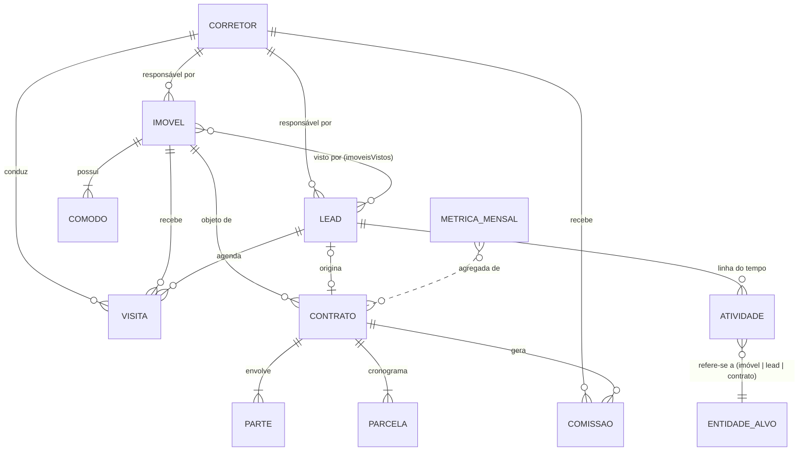

# Atrium — Modelo de dados mock (desenho)

> Desenho da Fase 2. A implementação (tipos TypeScript + schemas Zod + gerador + `fakeApi`) é a Fase 5.
> Convenções: IDs são strings com prefixo (`imv_…`, `lead_…`); datas em ISO 8601; **valores monetários em centavos (inteiros)**; áreas em m² (número); enums em minúsculas sem acento no código e rotulados em pt-BR na UI.

## 1. Diagrama de entidades

## 2. Entidades

### Corretor
| Campo | Tipo | Notas |
|---|---|---|
| id | `cor_…` | |
| nome | string | inclui 1 nome muito longo (caso de borda) |
| email, telefone | string | fictícios, sem dados reais |
| creci | string | formato `CRECI-SP 123456-F` fictício |
| avatar | `{ iniciais, variante? }` | ilustração SVG ou iniciais (Fase 5) |
| papel | `gestor \| corretor \| financeiro` | usado pelo seletor de persona (RF-08) |
| metaMensal | centavos | para "meta x realizado" no dashboard |
| ativo | boolean | |

### Imovel
| Campo | Tipo | Notas |
|---|---|---|
| id, codigo | `imv_…`, `AT-0001` | código visível e buscável (RF-22) |
| titulo, descricao | string | 1 título muito longo |
| tipo | `casa \| apartamento \| cobertura \| terreno \| comercial` | define a ilustração da fachada |
| finalidade | `venda \| locacao` | |
| status | `disponivel \| reservado \| vendido \| alugado \| inativo` | ver regras §3 |
| preco | centavos | venda: valor total; locação: aluguel mensal |
| condominio, iptu | centavos \| null | IPTU anual; terreno sem condomínio |
| areaUtil, areaTotal | número (m²) | `areaUtil ≤ areaTotal` |
| quartos, suites, banheiros, vagas | inteiro | `suites ≤ quartos`; terreno = 0 |
| endereco | `{ logradouro, numero, bairro, cidade, uf, cep }` | bairros plausíveis e genéricos |
| comodos | `Comodo[]` | ≥ 1 exceto terreno |
| diferenciais | string[] | ex.: piscina, academia, portaria 24 h |
| corretorId | → Corretor | |
| favorito | boolean | RF-28 |
| motivoInativo | string \| null | quando `inativo` |
| criadoEm, atualizadoEm | ISO | |

### Comodo (valor embutido em Imovel)
| Campo | Tipo | Notas |
|---|---|---|
| tipo | `sala \| cozinha \| quarto \| banheiro \| varanda \| garagem \| areaGourmet \| escritorio` | define a ilustração SVG |
| nome | string | ex.: "Suíte master" |
| area | número (m²) \| null | |

### Lead
| Campo | Tipo | Notas |
|---|---|---|
| id | `lead_…` | |
| nome | string | |
| contato | `{ telefone?, email? }` | **pode estar vazio** (caso de borda) |
| origem | `site \| portal \| indicacao \| whatsapp \| placa \| redes` | |
| etapa | `novo \| contato \| visita \| proposta \| fechado \| perdido` | kanban (RF-30) |
| motivoPerda | `preco \| localizacao \| desistencia \| concorrencia \| outro` \| null | obrigatório se `perdido` (RF-32) |
| interesse | `{ finalidade, tipos[], bairros[], quartosMin? }` | |
| orcamento | centavos \| null | soma por coluna no kanban |
| imoveisVistos | → Imovel[] | N:N |
| responsavelId | → Corretor | |
| ordem | número | posição dentro da coluna do kanban |
| criadoEm, atualizadoEm | ISO | |

### Visita
| Campo | Tipo | Notas |
|---|---|---|
| id | `vis_…` | |
| imovelId, leadId, corretorId | refs | |
| dataHora | ISO | alimenta "próximos compromissos" (RF-14) |
| status | `agendada \| realizada \| cancelada \| naoCompareceu` | |
| observacao | string? | |

### Contrato
| Campo | Tipo | Notas |
|---|---|---|
| id, numero | `ctr_…`, `CT-2026-0001` | |
| tipo | `venda \| locacao` | igual à finalidade do imóvel |
| imovelId | → Imovel | |
| leadId | → Lead \| null | lead que originou (fechado) |
| partes | `Parte[]` | |
| valor | centavos | venda: total; locação: aluguel mensal |
| inicio, fim | ISO (data) | venda: `fim` = data da escritura; locação: 12–30 meses |
| status | `rascunho \| ativo \| encerrado \| cancelado` | "inadimplente" é **derivado** (§3) |
| motivoCancelamento | string \| null | RF-48 |
| taxaAdministracao | % \| null | só locação (repasse, RF-46) |
| parcelas | `Parcela[]` | |
| comissoes | `Comissao[]` | |

### Parte (valor embutido em Contrato)
| Campo | Tipo |
|---|---|
| papel | `comprador \| vendedor \| locatario \| locador \| fiador` |
| nome, documento | string (documento fictício e mascarado na UI) |

### Parcela (valor embutido em Contrato)
| Campo | Tipo | Notas |
|---|---|---|
| numero | inteiro | 1…n |
| vencimento | ISO (data) | |
| valor | centavos | |
| pagoEm | ISO \| null | |
| status | **derivado**: `pago` se `pagoEm`; `atrasado` se hoje > vencimento; senão `aVencer` | não é armazenado |

### Comissao (valor embutido em Contrato)
| Campo | Tipo |
|---|---|
| corretorId | → Corretor |
| percentual | % |
| base | centavos: **venda** = valor total do contrato; **locação** = primeiro aluguel (`valor` mensal), comissão única no início |
| valor | centavos (derivado: base × percentual) |
| competencia | `AAAA-MM` (venda: mês da assinatura; locação: mês de `inicio`) — usada em "comissões do mês" (RF-44) |
| pagaEm | ISO \| null |

### Atividade
| Campo | Tipo | Notas |
|---|---|---|
| id | `atv_…` | |
| tipo | `etapaAlterada \| nota \| visitaAgendada \| visitaRealizada \| propostaEnviada \| imovelCriado \| precoAlterado \| statusAlterado \| pagamentoRegistrado \| contratoCriado` | |
| alvo | `{ tipo: 'imovel' \| 'lead' \| 'contrato', id }` | relação polimórfica principal |
| relacionados | `{ tipo, id }[]` | outras entidades afetadas (ex.: visita aparece na linha do tempo do lead **e** do imóvel) |
| autorId | → Corretor | |
| dados | objeto por tipo | ex.: `{ de: 'visita', para: 'proposta' }` |
| criadoEm | ISO | feed do dashboard (RF-13) e linhas do tempo (RF-26, RF-34). O histórico do imóvel é derivado daqui (atividades com o imóvel em `alvo` ou `relacionados`), não é armazenado à parte |

### MetricaMensal (derivada)
`{ mes: 'AAAA-MM', receitaVendas, receitaLocacoes, comissoes, leadsNovos, visitas, contratosFechados }` — **calculada na consulta** (`getDashboard`/`getFinanceiro`) a partir de contratos, parcelas, comissões, leads e visitas, para refletir imediatamente qualquer alteração salva (ex.: RF-43). Não é armazenada; uma cópia pré-calculada existe só como *fixture* de teste para conferir o cálculo.

## 3. Regras e invariantes

Garantidas pelo gerador do mock **e** pelas máquinas de estado do domínio, que são o único ponto de mudança de status (o `fakeApi` só as chama). Transições, guards e efeitos completos: [`ESTADOS-E-FLUXOS.md`](./ESTADOS-E-FLUXOS.md).

1. Contrato de **venda** `ativo`/`encerrado` ⇒ imóvel `vendido`; contrato de **locação** `ativo` ⇒ imóvel `alugado`. Ao encerrar uma locação ou cancelar um contrato, o imóvel volta a `disponivel`.
2. `vendido`/`alugado` só são atingidos via contrato (RF-25); `setStatusImovel` aceita apenas `disponivel ↔ reservado ↔ inativo` e recusa a mudança se o imóvel tiver contrato ativo.
3. `Contrato.leadId` preenchido ⇒ esse lead está `fechado`. O inverso não é exigido: um lead pode estar `fechado` sem contrato vinculado (RF-39).
4. Lead `perdido` ⇒ `motivoPerda` preenchido; ao sair de `perdido`, `motivoPerda` volta a `null`.
5. Contrato **inadimplente** = `ativo` com ao menos uma parcela `atrasado` (derivado; RF-41/RF-44).
6. `tipo` do contrato = `finalidade` do imóvel.
7. Soma das parcelas de venda = `valor`; locação: uma parcela por mês de vigência, cada uma = `valor`.
8. Toda mudança de etapa, status, preço, pagamento ou contrato gera uma `Atividade` (alimenta linhas do tempo, feed e notificações).

## 4. Volume e casos de borda (para a Fase 5)

~48 imóveis · ~60 leads · ~30 contratos · 8 corretores · 12 meses de métricas · ~120 visitas · ~400 atividades.
Casos embutidos: nome e título muito longos; imóvel sem cômodos (terreno) e sem ilustração (fallback); lead sem contato; contrato vencido e contrato com 3 parcelas atrasadas; valores extremos (aluguel R$ 900 e venda R$ 12 mi); coluna do kanban vazia; filtro sem resultado.

## 5. Operações do `fakeApi` (contrato para a Fase 5)

| Função | Usada por |
|---|---|
| `getDashboard(periodo)` | RF-10…16 |
| `listCorretores()` | filtros (RF-36), RF-16, RF-08 |
| `listImoveis(filtros, paginacao, ordem)` · `getImovel(id)` · `saveImovel(dados)` | RF-20…24, RF-27 |
| `setStatusImovel(id, status, motivo?)` · `setStatusImoveis(ids, status)` | RF-25, RF-49 |
| `toggleFavorito(id)` | RF-28 |
| `listAtividades({ alvo, limite })` | RF-13, RF-26, RF-34 |
| `listLeads(filtros)` (inclui `imovelId` e `responsavelId`) · `getLead(id)` | RF-29, RF-30, RF-33, RF-36, RF-38 |
| `moveLead(id, etapa, ordem, motivo?)` · `createLead(dados)` · `addNota(leadId, texto)` · `vincularContrato(leadId, contratoId)` | RF-31, RF-32, RF-34, RF-35, RF-39 |
| `agendarVisita(dados)` · `updateVisita(id, status)` | RF-14, RF-37 |
| `listContratos(filtros, paginacao, ordem)` · `getContrato(id)` | RF-40…42 |
| `registrarPagamento(contratoId, numero)` · `cancelarContrato(id, motivo)` | RF-43, RF-48 |
| `getFinanceiro(periodo)` | RF-44…46 |
| `listNotificacoes()` · `marcarLida(id)` | RF-64 |
| `search(termo)` | RF-02 |
| `getPerfil()` · `savePerfil(dados)` | RF-50 |
| `resetMock()` · `configurar({ latencia, taxaErro })` | RF-51 |

**Desfazer (RF-04):** toda operação de escrita retorna `{ resultado, desfazer }`, onde `desfazer()` restaura o estado anterior (snapshot da entidade + remoção da atividade gerada). Assim "Desfazer" funciona igual para mover lead, mudar status, registrar pagamento e favoritar.

Todas retornam `Promise` com latência de 300–800 ms e taxa de erro configurável.
