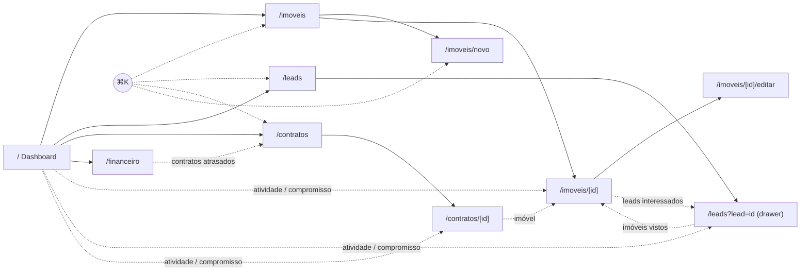

# Atrium — Requisitos e escopo (Fase 2)

> Versão MVP com **dados mock** e **ilustrações SVG**, sem backend.
> Rastreabilidade: cada RF/RNF tem um ID estável. As telas (Fase 8) e os testes (Fase 10) citam esses IDs.
> Mapa de rotas: seção 6 · Modelo de dados: [`MODELO-DE-DADOS.md`](./MODELO-DE-DADOS.md).

## 1. Personas

| Persona | Objetivo principal | Contexto de uso | Telas mais usadas | Sucesso para ela |
|---|---|---|---|---|
| **Gestor(a) da imobiliária** | Ver o resultado e agir sobre desvios | Desktop, começo do dia e reuniões | Dashboard, Financeiro, Leads (visão geral) | Em < 10 s sabe se o mês está bom e onde está o gargalo |
| **Corretor(a)** | Gerir os próprios imóveis e leads rápido | Desktop no escritório, **celular na rua** (entre visitas) | Leads (kanban), Imóveis, detalhe do lead | Atualiza a etapa de um lead ou o status de um imóvel em ≤ 3 toques |
| **Financeiro/administrativo** | Controlar contratos, vencimentos e repasses | Desktop, rotina diária/mensal | Contratos, Financeiro | Vê o que vence e o que está atrasado sem montar planilha |

**Usuário no mock:** não há autenticação (ver §5); há um único usuário atual fixo, editável em Configurações (RF-50). "Meus leads" filtra pelo responsável = usuário atual.

## 2. Requisitos funcionais

Prioridade: **M** = must (MVP), **S** = should (entra se não atrasar o Gate 8).

### 2.1 Transversais

| ID | Requisito | Prior. |
|---|---|---|
| RF-01 | Navegação entre módulos por sidebar (desktop) e drawer (mobile), com item ativo destacado. | M |
| RF-02 | Busca global e atalhos por paleta de comandos (⌘K / Ctrl+K): imóveis por código/título, leads por nome, contratos por número, e ações ("Novo imóvel", "Novo lead"). | M |
| RF-03 | Alternar tema claro/escuro/sistema; preferência persistida. | M |
| RF-04 | Toda ação que altera dados mostra feedback (toast). "Desfazer" no toast para: mover lead, mudar status (imóvel/contrato) e registrar pagamento. | M |
| RF-05 | Ações destrutivas (inativar imóvel, marcar lead como perdido, cancelar contrato) pedem confirmação descrevendo o impacto. Não há exclusão definitiva no MVP. | M |
| RF-06 | Filtros, ordenação, paginação e modo de visualização refletidos na URL (link compartilhável, botão voltar funciona). | M |
| RF-07 | Formatação pt-BR: moeda (R$ 1.234,56), área (m²), datas (dd/mm/aaaa e relativas: "há 2 h"), telefone ((11) 91234-5678). | M |
| RF-09 | Densidade de tabelas (confortável/compacta), persistida. | S |

### 2.2 Dashboard

| ID | Requisito | Prior. |
|---|---|---|
| RF-10 | KPIs: imóveis ativos, leads novos (mês), visitas agendadas (próximos 7 dias), receita do mês; cada um com variação vs. mês anterior (▲▼ + cor + texto) e mini tendência. | M |
| RF-11 | Gráfico de receita dos últimos 12 meses (vendas × locações), com tooltip acessível e tabela alternativa. | M |
| RF-12 | Funil resumido de leads por etapa, com quantidade e taxa de conversão entre etapas. | M |
| RF-13 | Atividades recentes (últimas 10), cada uma levando ao registro de origem. | M |
| RF-14 | Próximos compromissos (visitas e vencimentos dos próximos 7 dias). | M |
| RF-15 | Filtro de período do dashboard (mês atual, mês anterior, últimos 3/12 meses). | S |
| RF-16 | Meta × realizado do mês (receita e contratos fechados), geral e por corretor, a partir da meta mensal de cada corretor. | S |

### 2.3 Imóveis

| ID | Requisito | Prior. |
|---|---|---|
| RF-20 | Listagem em **grade** (cartões) e **lista** (tabela), com alternância persistida. | M |
| RF-21 | Filtros: tipo, finalidade (venda/locação), status, bairro, faixa de preço, quartos (1, 2, 3, 4+); chips de filtros ativos removíveis e "Limpar tudo". | M |
| RF-22 | Busca por código, título ou bairro, com resultado enquanto digita (debounce). | M |
| RF-23 | Ordenação por mais recentes, preço (↑↓), área. Paginação com total de resultados. | M |
| RF-24 | Detalhe do imóvel: galeria de cômodos (SVG) navegável por teclado, ficha técnica (áreas, quartos, suítes, banheiros, vagas, condomínio, IPTU), diferenciais, descrição, corretor responsável. | M |
| RF-25 | Status do imóvel: disponível, reservado, vendido, alugado, inativo. O usuário altera manualmente só entre **disponível, reservado e inativo**; **vendido/alugado** decorrem do contrato (ativo/encerrado) e não são editáveis à mão. Toda alteração tem confirmação e entra no histórico. | M |
| RF-26 | Histórico do imóvel (criação, mudanças de preço/status, visitas, propostas). | M |
| RF-27 | Criar e editar imóvel em formulário multi-seção com validação inline; cômodos escolhidos de uma lista (ilustração automática por tipo). | M |
| RF-28 | Marcar imóvel como favorito/destaque (filtro "Favoritos"). | S |
| RF-29 | Ver leads interessados no imóvel (a partir do detalhe). | S |

### 2.4 Leads / CRM

| ID | Requisito | Prior. |
|---|---|---|
| RF-30 | Quadro kanban por etapa: Novo → Contato → Visita → Proposta → Fechado / Perdido; cada coluna com contagem e soma do orçamento. | M |
| RF-31 | Mover lead para qualquer etapa por arrastar e soltar **e** por alternativa sem arrastar (menu "Mover para…" e teclado). | M |
| RF-32 | Mover para "Perdido" exige motivo (preço, localização, desistência, concorrência, outro). | M |
| RF-33 | Detalhe do lead (drawer): contato, origem, orçamento, interesses (tipo, bairros, quartos), imóveis vistos, responsável. | M |
| RF-34 | Linha do tempo do lead (mudanças de etapa, visitas, propostas, notas), com adição de nota. | M |
| RF-35 | Criação rápida de lead (nome + contato + origem) a partir do kanban e da paleta de comandos. | M |
| RF-36 | Filtrar o kanban por responsável, origem e período; "Meus leads" como atalho. | M |
| RF-37 | Agendar visita a partir do lead (imóvel, data, hora), que aparece em compromissos (RF-14). | S |
| RF-38 | Alternar kanban ↔ lista (tabela) dos leads. | S |
| RF-39 | Ao mover um lead para Fechado, oferecer vincular um contrato existente do imóvel (opcional; o lead pode ficar fechado sem contrato). | S |

### 2.5 Contratos e financeiro

| ID | Requisito | Prior. |
|---|---|---|
| RF-40 | Lista de contratos (venda/locação) em tabela: número, imóvel, partes, valor, vigência, status, próximo vencimento. | M |
| RF-41 | Filtros por tipo, status (rascunho, ativo, encerrado, cancelado, inadimplente) e período de vencimento. | M |
| RF-42 | Detalhe do contrato: partes, imóvel, valores, vigência, comissão, cronograma de parcelas/aluguéis com status (pago, a vencer, atrasado). | M |
| RF-43 | Registrar pagamento de uma parcela (mock) com feedback e "Desfazer". | M |
| RF-44 | Indicadores: receita recebida no mês, a receber, inadimplência (valor e %), comissões do mês. | M |
| RF-45 | Resumo financeiro: receita por mês (12 meses), comissões por corretor, parcelas atrasadas por faixa (1–30, 31–60, 60+ dias). | M |
| RF-46 | Repasses ao proprietário (locação): valor do aluguel − taxa de administração, por mês. | S |
| RF-47 | Exportar a tabela visível em CSV (gerado no cliente). | S |
| RF-48 | Cancelar contrato (com motivo), voltando o imóvel a disponível; ação destrutiva com confirmação (RF-05). | M |
| RF-49 | Seleção em lote nas tabelas (imóveis em lista, contratos) com ações em massa: exportar CSV e, em imóveis, alterar status permitido (RF-25). | S |

### 2.6 Shell (layout)

| ID | Requisito | Prior. |
|---|---|---|
| RF-60 | Sidebar recolhível (só ícones + tooltips), com estado persistido. | M |
| RF-61 | Breadcrumb e cabeçalho de página (título, descrição, ação primária) em todas as telas. | M |
| RF-63 | No mobile: sidebar em drawer e barra de ação inferior com a ação primária da tela. | M |

### 2.7 Configurações

| ID | Requisito | Prior. |
|---|---|---|
| RF-50 | Perfil do usuário atual (mock), tema e densidade. | M |
| RF-51 | Controles de demonstração: latência e taxa de erro do `fakeApi`, e "restaurar dados mock". | S |

### 2.8 Registro de alterações

| ID | Requisito | Prior. |
|---|---|---|
| RF-65 | Seção "Histórico de alterações" no detalhe de imóvel, lead e contrato: quem alterou preço, status ou valor monetário, quando, e valor anterior → novo. | M |

## 3. Requisitos não funcionais

| ID | Requisito | Como verificar |
|---|---|---|
| RNF-01 | Responsivo de **360 px a 1920 px** (layout de referência); desktop-first, mas todos os fluxos M utilizáveis no celular (tabelas viram cartões, sidebar vira drawer). Sem rolagem horizontal da página em **320 px CSS** (reflow, WCAG 1.4.10) e com **zoom de 200 %** sem perda de conteúdo (1.4.4); tabelas largas rolam dentro do próprio contêiner. | Playwright nos 4 breakpoints + 320 px + zoom 200 % |
| RNF-02 | **WCAG 2.2 AA**. | axe sem violações sérias/críticas + revisão manual |
| RNF-03 | Navegação **completa por teclado**, foco sempre visível (`--ring` 2 px + offset 2 px), ordem lógica, *skip link*. | Roteiro de teclado por tela |
| RNF-04 | Alvos de toque ≥ 24 px (WCAG 2.5.8); padrão do projeto 40 px no desktop e 44 px no mobile. | Inspeção + teste visual |
| RNF-05 | Contraste: todas as combinações de `contrast.json` aprovadas nos dois temas. | `npm run check:contrast` na CI |
| RNF-06 | Lighthouse ≥ 95 em Performance, Acessibilidade e Boas práticas (mobile e desktop). | Lighthouse CI no build de produção |
| RNF-07 | Web Vitals: **LCP < 2,0 s**, **CLS < 0,05**, **INP < 200 ms**. | Lighthouse + `web-vitals` em dev |
| RNF-08 | Respeitar `prefers-reduced-motion` (durações → 1 ms, sem parallax) e `prefers-color-scheme`. | Emulação no Playwright |
| RNF-09 | Toda tela e todo composto cobre os estados **loading (skeleton) · vazio · erro (com tentar de novo) · sucesso · parcial**. | Stories + E2E com `fakeApi` em erro |
| RNF-10 | Zero valores de estilo fora dos tokens (cor, espaço, raio, sombra, duração). | `npm run check:hex` + regra de lint (Fase 3) |
| RNF-11 | Interface 100 % em pt-BR, incluindo mensagens de erro, `aria-label` e textos alternativos. | Revisão + teste de snapshot |
| RNF-12 | TypeScript `strict`; dados mock validados por schemas Zod. | `tsc --noEmit` + teste dos schemas |
| RNF-13 | Funciona sem backend e sem variáveis de ambiente; deploy estático/serverless na Vercel com o mock. | `next build` sem `.env` |
| RNF-14 | Segurança de repositório público: nenhum segredo versionado; cabeçalhos de segurança (nosniff, frame DENY, referrer, permissions). | `.gitignore` + CI + inspeção de headers |
| RNF-15 | Navegadores: últimas 2 versões de Chrome, Safari, Firefox e Edge; iOS Safari e Android Chrome. | Playwright (chromium/webkit/firefox) |
| RNF-16 | Persistência local (tema, densidade, visualização, alterações do mock) em `localStorage`, tolerante a falhas (modo privado). | Teste com storage bloqueado |
| RNF-17 | Todo gráfico (receita, funil, distribuição, financeiro) tem alternativa textual: tabela de dados acessível e resumo em texto. | axe + leitor de tela |
| RNF-18 | Mensagens de status (toasts, "salvo", contagem de resultados após filtrar) anunciadas por *live region* sem mover o foco (WCAG 4.1.3). | Teste com leitor de tela |
| RNF-19 | Listas e tabelas com mais de 100 itens renderizados usam virtualização; a interação continua dentro da meta de INP. | Teste com volume extremo do mock |
| RNF-20 | Fluxos críticos (etapa do lead, status do imóvel e do contrato, pagamento, comissão, desfazer) implementados como máquinas de estado explícitas em `src/domain/`, sendo o único ponto de mudança; nenhuma regra desses fluxos espalhada em componentes. | Testes por transição + revisão de código ([`ESTADOS-E-FLUXOS.md`](./ESTADOS-E-FLUXOS.md)) |
| RNF-21 | Toda alteração de preço, status ou valor monetário gera registro (quem, quando, campo, de → para), gravado pela função do domínio. | Teste: cada alteração desses campos cria um registro |

## 4. Fora de escopo (nesta versão)

- Backend, banco de dados e API real (tudo é `fakeApi` em memória + `localStorage`).
- Autenticação, autorização e multiusuário real (persona é só um seletor de demonstração).
- Pagamentos, boletos, Pix e conciliação bancária.
- Upload real de imagens e documentos (imóveis usam ilustrações SVG).
- Integrações: portais imobiliários, WhatsApp, e-mail, calendário, assinatura eletrônica.
- Notificações (push, e-mail ou central in-app).
- Internacionalização (só pt-BR) e múltiplas moedas.
- Geração de contrato em PDF.

## 5. Premissas e decisões

- **Persistência do mock:** alterações feitas pelo usuário (mover lead, registrar pagamento, editar imóvel) sobrevivem ao recarregar via `localStorage`; "Restaurar dados mock" volta ao estado inicial (RF-51).
- **Datas relativas a hoje:** o gerador do mock ancora as datas na data atual, para o dashboard sempre parecer "vivo".
- **Moeda em centavos:** valores monetários são inteiros em centavos no modelo, formatados só na UI (evita erro de ponto flutuante).
- **Um responsável por registro:** imóveis e leads têm um corretor responsável; contratos guardam a comissão por corretor.
- **Indicadores sempre derivados:** KPIs e métricas são calculados na consulta a partir dos dados atuais, para refletir na hora qualquer alteração (ex.: registrar pagamento atualiza o Financeiro).

## 6. Mapa de telas e navegação

Rotas do App Router (grupo `(dashboard)` compartilha o shell da Fase 7).

| Rota | Tela | Persona principal | RFs |
|---|---|---|---|
| `/` | Dashboard | Gestor | RF-10…16 |
| `/imoveis` | Imóveis — lista (grade/lista, filtros na URL) | Corretor | RF-20…23, RF-28, RF-49 |
| `/imoveis/novo` | Imóvel — criação | Corretor | RF-27 |
| `/imoveis/[id]` | Imóvel — detalhe (galeria, ficha, histórico de alterações) | Corretor | RF-24…26, RF-29, RF-65 |
| `/imoveis/[id]/editar` | Imóvel — edição | Corretor | RF-27 |
| `/leads` | Leads — kanban (ou lista via `?view=lista`) | Corretor | RF-30…32, RF-35, RF-36, RF-38, RF-39 |
| `/leads?lead=<id>` · `/leads/[id]` | Lead — detalhe (drawer sobre o kanban via query; página cheia no acesso direto) | Corretor | RF-33, RF-34, RF-37 |
| `/contratos` | Contratos — tabela | Financeiro | RF-40, RF-41, RF-47, RF-49 |
| `/contratos/[id]` | Contrato — detalhe e cronograma | Financeiro | RF-42, RF-43, RF-46, RF-48 |
| `/financeiro` | Financeiro — resumo | Gestor, Financeiro | RF-44, RF-45 |
| `/configuracoes` | Configurações | Todos | RF-03, RF-09, RF-50, RF-51 |
| `/design-system/colors` | Referência: cores (Fase 1) | Time | — |
| `/design-system/illustrations` | Referência: SVGs (Fase 5) | Time | — |

**Globais (em todas as telas do shell):** sidebar/drawer (RF-01, RF-60), topbar com busca ⌘K (RF-02), alternador de tema (RF-03), breadcrumb (RF-61), toasts (RF-04, RNF-18), *skip link* (RNF-03).

**Estrutura no App Router (Next.js 16):**

```
src/app/
  layout.tsx                       # html, fontes, ThemeProvider
  (dashboard)/
    layout.tsx                     # shell (Fase 7)
    page.tsx                       # "/" Dashboard — substitui o src/app/page.tsx provisório (redirect da Fase 1)
    imoveis/  page.tsx · novo/page.tsx · [id]/page.tsx · [id]/editar/page.tsx
    leads/  page.tsx                 # kanban; o detalhe abre em drawer via ?lead=<id> (link compartilhável)
            [id]/page.tsx            # detalhe em página cheia (acesso direto)
    contratos/  page.tsx · [id]/page.tsx
    financeiro/page.tsx
    configuracoes/page.tsx
    design-system/  colors/page.tsx · illustrations/page.tsx
```



**Ordem do menu:** Dashboard · Imóveis · Leads · Contratos · Financeiro — e, separado no rodapé, Configurações. (Lei de Hick: 5 itens principais.)

## 7. Critérios de aceite do MVP (Gate 8)

- Todos os RFs **M** atendidos; RFs **S** atendidos ou justificados aqui.
- Fluxos principais ponta a ponta com mock: filtrar imóveis → abrir detalhe; mover lead (arrastar e teclado) → ver na linha do tempo; abrir contrato → registrar pagamento → ver indicador atualizar; alternar tema.
